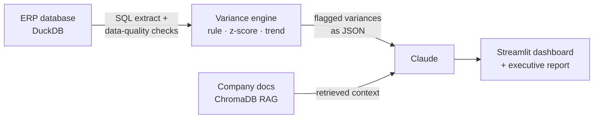

# AI Variance Analyst

**Budget vs. actual analysis for FP&A teams: flags the variances that matter, then explains them in a CFO-ready report grounded in company context.**

**[▶ Live demo](https://huggingface.co/spaces/PhatNguyen39/ai-variance-analyst)** · [Sample AI report](outputs/sample_ai_report.md)

<!-- Screenshot: save a capture of the dashboard as docs/dashboard.png and uncomment the next line -->
<!--  -->

Every month-end, finance teams answer the same questions: *Why did marketing spike in Q3? What's driving the revenue miss? Which variances are expected and which are real problems?* This app automates that loop on a mock ERP for a fictional SaaS company (synthetic data, 14 GL accounts × 6 departments × FY2024).

## Highlights

- **SQL data layer (DuckDB):** actuals are extracted from journal-entry lines with month-end close controls (only posted entries in locked periods), and five data-quality checks run before any analysis.
- **Three-method anomaly detection:** a materiality rule, per-account z-scores, and 3-month trends, implemented in both Python and SQL and tested to give identical results.
- **Grounded LLM reports:** RAG over company documents (budget assumptions, seasonality, past variances) feeds Claude, which writes an executive summary, driver attribution, risks, and actions.
- **Hallucination check you can run:** an eval extracts every `$` and `%` figure in a generated report and verifies it traces back to the source data.
- **47 automated tests**, no API key needed.

## How it works



**Key design decisions**

- **SQL with close controls, not a flat file.** The extract counts only `POSTED` entries in `LOCKED` periods, maps GL codes to P&L lines, and handles the edge cases explicitly (nothing posted → 0, open month → no actual, zero budget → no divide-by-zero). Checks catch unmapped GL codes, unknown departments, drafts left in closed months, actuals with no budget, and duplicate postings. See [`sql/`](sql/).
- **Detection tuned to avoid noise.** A variance is flagged if it is over 10% *and* over $5K, a z-score above 2 within its account, or 3 straight months moving the same way by more than 5%. Severity runs from LOW to CRITICAL.
- **RAG instead of fine-tuning.** Budget assumptions and business events change every fiscal year; retrieval updates the context without retraining, and each explanation can be traced to a source document.
- **Numbers never come from the model.** Figures are passed to the LLM as structured JSON, the prompt forbids inventing numbers, and the model must say so when the context doesn't explain a variance.

## Demo scenarios

The synthetic data includes planted events, a mix of expected and unexpected, for the system to find and explain:

| Event | Period | Variance | Expected? |
|---|---|---|---|
| Marketing overspend (brand campaign + user conference) | Jul–Sep 2024 | +22–45% | Yes, planned |
| SaaS revenue miss (enterprise customer churn) | Jul–Sep 2024 | −15–23% | No |
| Cloud infrastructure spike (architecture migration) | Oct–Nov 2024 | +24–35% | No |
| Travel spike (sales kickoff) | Apr 2024 | +53% | Yes, planned |
| Legal fees spike (contract renegotiation) | Nov 2024 | +64% | No |
| Professional services revenue beat | Oct–Nov 2024 | +9–30% | No |

## Testing and evaluation

- **Unit tests (47):** threshold boundaries, z-score and trend detection, deduplication, severity ordering, and revenue beat/miss labeling, on hand-computed fixtures.
- **SQL tests:** small hand-built ledgers check every extract rule and data-quality check; parity tests confirm the SQL pipeline matches the Python engine row for row on the full dataset.
- **LLM groundedness eval** ([`eval/eval_narrative.py`](eval/eval_narrative.py)): checks that every cited figure matches the source data within rounding, and that all four report sections are present with the executive summary under 150 words. It calls the Claude API, so it runs manually rather than in CI; its parsing logic has its own unit tests. **Latest run (2026-11-24): 0 untraceable figures.**

```bash
pytest tests/          # no API key needed
```

## Tech stack

| Area | Tools |
|---|---|
| Data & SQL | DuckDB, pandas, NumPy |
| Detection | SciPy, pandas, SQL window functions |
| RAG | ChromaDB, sentence-transformers |
| LLM | Anthropic Claude API |
| App | Streamlit, Plotly |
| Testing | pytest |

## Run locally

```bash
git clone https://github.com/NGUYENTHINHPHAT/ai-variance-analyst.git
cd ai-variance-analyst
pip install -r requirements.txt
streamlit run app.py
```

The app generates the data and builds the database on startup. AI reports need an [Anthropic API key](https://console.anthropic.com), entered in the sidebar; the dashboard and charts work without one.

---

[MIT License](LICENSE)
